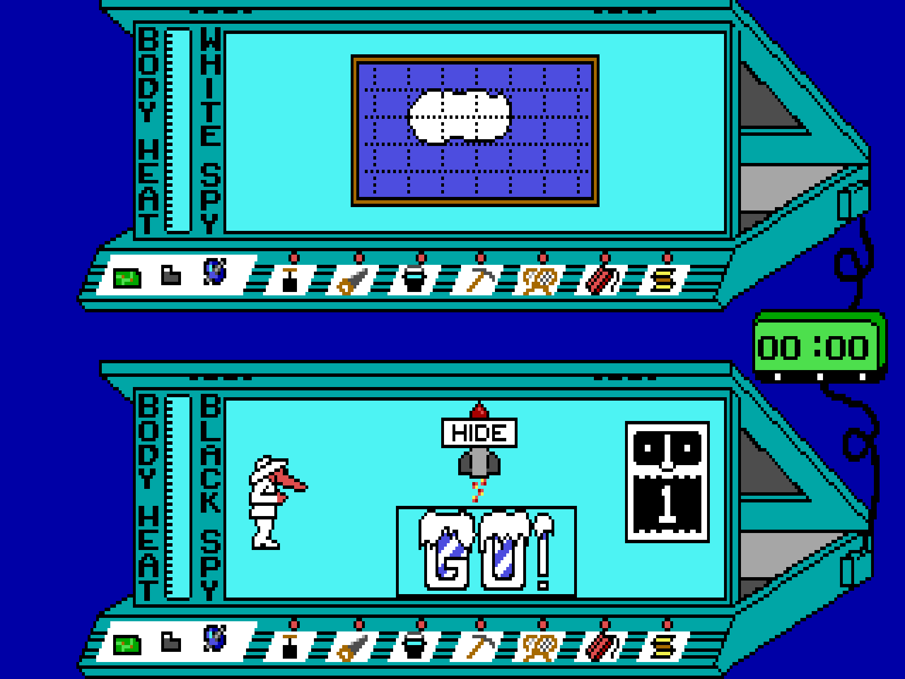
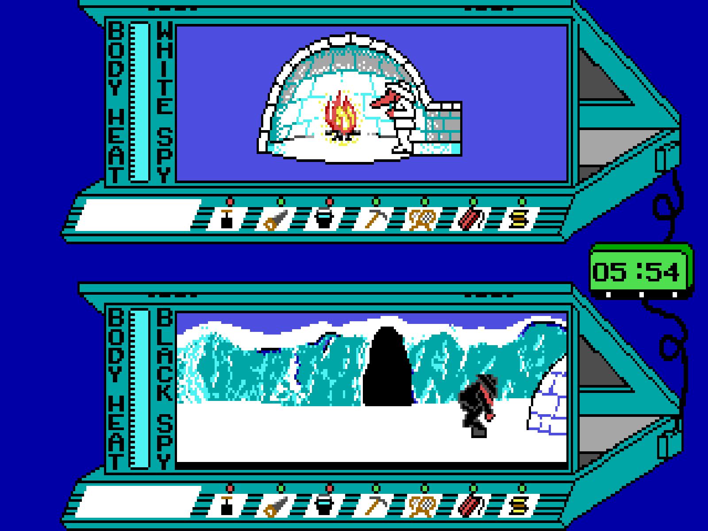
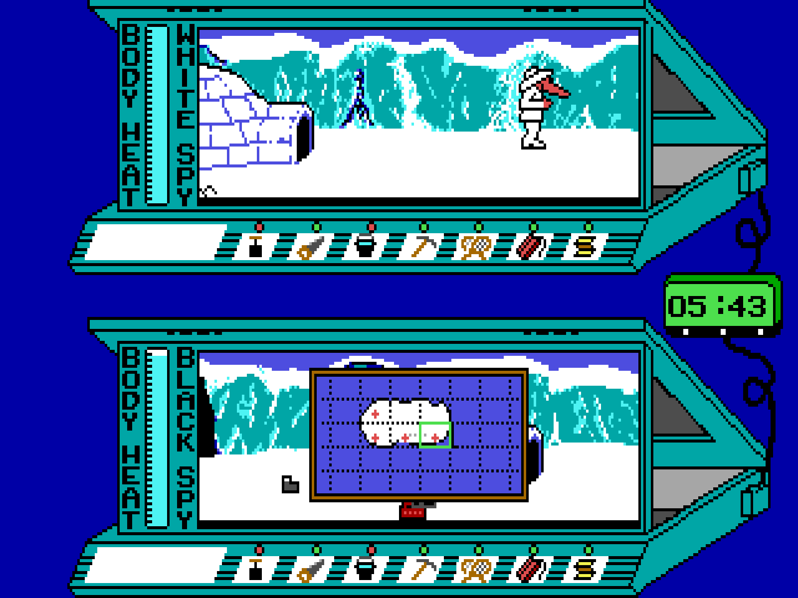
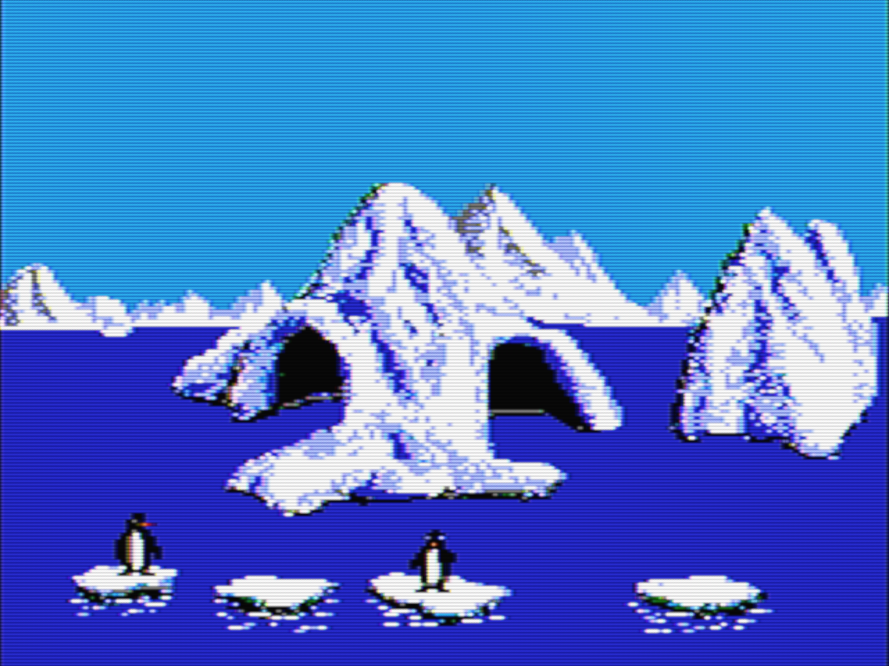
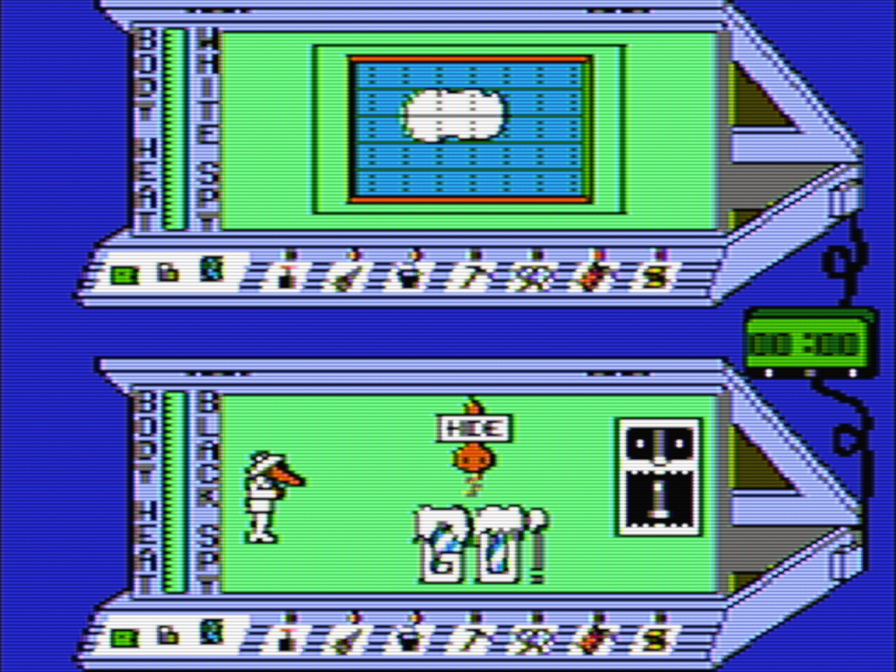

# Arctic Antics

An independently written reconstruction of **Spy vs. Spy III: Arctic Antics**. Two spies race across the arctic islands to collect three mission items and escape in a rocket, setting traps for each other while the cold, the water and the clock run down. Play against the computer or against a friend on one keyboard.

It runs as:

- a **DOS** program for real 8086/8088-or-later PCs and DOSBox, with EGA/VGA or Tandy/PCjr graphics (and CGA composite colours on request) and PC speaker, Tandy or AdLib sound;
- a **native** program for Windows, Linux and macOS, with gamepad support.

The project contains no original game files. You supply your own copy of the original DOS game, and the installer builds your personal copy from it.

## Screenshots

EGA graphics:

CGA composite colours:

Click an image to see it full size.

## Get it

- [Download the latest release](https://github.com/obrem/arctic_antics/releases/latest)
- [Installation guide](install.html)
- [What is different from the original](changes.html)

## Help

- [Report a bug or request a feature](https://github.com/obrem/arctic_antics/issues/new/choose)
- [Browse known issues](https://github.com/obrem/arctic_antics/issues)

*Spy vs. Spy and Arctic Antics are the property of their respective owners. This project is an unofficial fan project and is not affiliated with or endorsed by them.*
